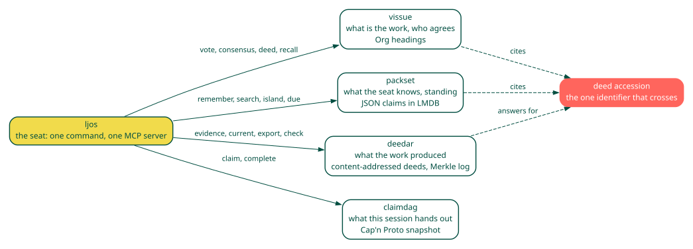

:description: ljos is memory, a shared tracker and a vote for coding agents. A person writes what the agents should remember. Every agent files and claims work on one git repository of tickets.
:cover: https://leidarljos.github.io/ljos/_static/og.png

.. raw:: html

   

     

       
       

         
ljos

         
What does this seat do next?

       

     

     
Remember, agree, hand over: memory for a working seat that a person can read on disk.

     

       Model agnostic
       Harness agnostic
       CLI + MCP
     

     

       <a class="vi-btn vi-btn-gold" href="getting-started.html">Get started</a>
       <a class="vi-btn vi-btn-ghost" href="reference.html">Reference</a>
     

   

ljos is memory, a shared tracker and a vote for coding agents. A
person writes what the agents should remember. Every agent files and
claims work on one git repository of tickets. When agents disagree, they
vote, and ljos settles the vote. It calls no model, and every store is a
file a person can open.

|image1|

What it has done
================

============ ==============================================================================================================================================
8,057 tokens for the 20 core Model Context Protocol (MCP) tools, against 18,011 for all 52
139.1 ms     warm prompt hook median on a pack of 10,000 lessons, down from 196.3 ms; ``prompt-hook.rows-10000.after`` in hook-latency.txt
0 of 186     near-topic pairs merged; 12 of 78 duplicate pairs found
2,293        tests passed on the 0.40.0 release commit, 0 failed
MIT          licence; Rust; Linux and macOS
============ ==============================================================================================================================================

:doc:`What ljos does <introduction>` lists each feature and the file
that measured each number.

Mem0 and Zep run a model over what they ingest. ljos stores the sentence as written.
beads keeps a ticket queue in Dolt and an agent can claim one. ljos keeps Org headings in git, and one seat holds a ticket.
:doc:`How ljos compares <compare>` sets ljos beside beads, Mem0, Letta, Zep, Basic Memory and git-bug.

Install
=======

.. code:: console

   $ sh scripts/install.sh --no-embed
   $ export PATH="$HOME/.local/bin:$PATH"
   $ cd "$HOME"
   $ ljos doctor
   ljos is ready: memory, tracker and command guard work. Optional extras: `ljos doctor --all`.
   warn	seat source	no seat rule matched; reading every seat, so run `export LJOS_SEAT=NAME`.
   info	sitting gate	not active here: no agent runner is above this shell, so the person's git is not gated; under one, a commit, merge, rebase, cherry-pick or push waits for a live sitting
   ok	config	no ljos.toml key and no LJOS_ variable is set; defaults stand
   warn	ljos config	/home/you/.config/ljos/ljos.toml is missing, so run ljos doctor --fix

With no seat named, the ``seat source`` row warns that the read uses every seat. The ``sitting-gate`` row is ``info`` and says ``not active here`` when no agent runner is above the shell. The config row says the defaults stand when nothing is set. The ``ljos config`` row warns that the file is missing and names ``ljos doctor --fix``. Run ``ljos doctor`` from your home directory. In a checkout, the config row names ``.ljos/gates.toml`` instead.

From a checkout, that script installs the programs. A release attaches the same script as ``install.sh``.
The copy on the 0.41.1 release asked for a vissue archive that project does not publish. The 0.41.2 script fetches the archive the vissue release publishes.
``--no-embed`` leaves out the encoder, and search matches words.
The installer checks each download against its published SHA-256 sum.
It then runs ``ljos onboard`` for each coding runner it finds. When ``ljos doctor``
prints ``ljos is ready``, you are done. A row it prints instead names the
part that needs action. Git needs ``user.name`` and ``user.email`` before the first ticket. To install by hand instead:

.. code:: console

   $ cargo binstall --locked ljos packset deedar-cli claimdag-cli vissue-cli vissue-mcp ljos-policyd ljos-consensus
   $ ljos onboard
   $ ljos doctor

:doc:`Getting started <getting-started>` says what each program is.

First commands
==============

.. code:: console

   $ ljos remember "The lexical default is BM25+. It beat BM25 by two points on turns."
   remembered (lesson): The lexical default is BM25+. It beat BM25 by two points on turns.
     id a6ae2751, next review 2026-11-12 21:40 +00:00
   $ ljos search "lexical default"
   matched by words (encoder not installed)
   shown 1 of 1.
   Place 1 is the first row.
   The score orders the row. It is not whether the sentence is true.
   This seat's score gets a small boost.
   A closer row from another seat stays ahead.
   Checks: how many of them named this row.

   lesson, from an agent, today
     The lexical default is BM25+. It beat BM25 by two points on turns.
     place 1, score 0.81, checks 2/2, id a6ae2751
   $ ljos file "Pick a codec" -p demo

``ljos search`` prints the lesson when the query shares its words.
A word ranking splits an identifier, so ``list_scans`` matches ``list scans``.
A row that only shares a common word is left out, and the line is then
``No close matches for "..."``.
``ljos file`` prints the new id and commits the Org heading. :doc:`Getting started <getting-started>` has the full transcript, including a second seat.

Where to go next
================

- :doc:`Getting started <getting-started>`: the tutorial, from install to a ticket and a second seat.
- :doc:`How-to guides <howto>`: one task a page, from hooks and onboarding to handover, trust and sync.
- :doc:`Reference <reference>`: every verb, server tool and variable.
- :doc:`Explanation <explanation>` and :doc:`Architecture <architecture>`: why the design is what it is.
- :doc:`How ljos compares <compare>`: the other memory tools and agent trackers.
- :doc:`Integration <integration>` and :doc:`Grok Build <grok-build>`: the runners ljos sits in.

Community
=========

- Questions and bugs: `GitHub issues <https://github.com/leidarljos/ljos/issues>`__.
- Changes: `CONTRIBUTING.md <https://github.com/leidarljos/ljos/blob/develop/CONTRIBUTING.md>`__.
- Releases: `GitHub releases <https://github.com/leidarljos/ljos/releases>`__ and `CHANGELOG.md <https://github.com/leidarljos/ljos/blob/develop/CHANGELOG.md>`__.
- The other leiðarljós programs: `github.com/leidarljos <https://github.com/leidarljos>`__.

.. toctree::
   :maxdepth: 1
   :caption: Start
   :hidden:

   introduction
   compare

.. toctree::
   :maxdepth: 1
   :caption: Tutorial
   :hidden:

   getting-started

.. toctree::
   :maxdepth: 1
   :caption: How-to
   :hidden:

   howto
   integration
   grok-build

.. toctree::
   :maxdepth: 1
   :caption: Reference
   :hidden:

   reference
   seat

.. toctree::
   :maxdepth: 1
   :caption: Explanation
   :hidden:

   explanation
   architecture

